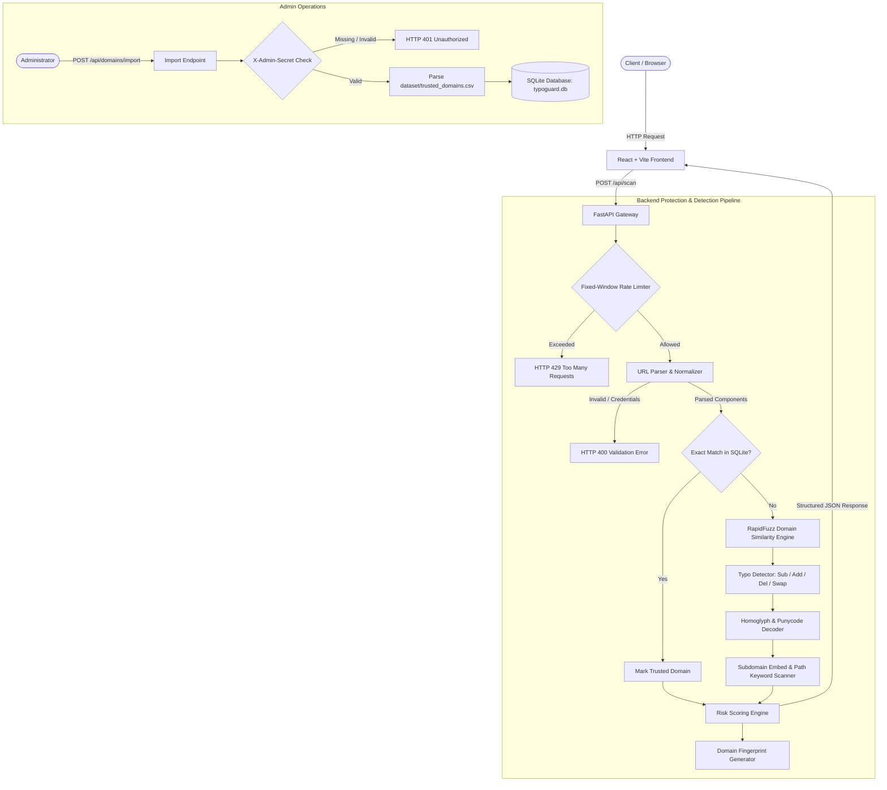

# TypoGuard — URL Typosquatting & Risk Scanner

[](https://www.python.org/)
[](https://fastapi.tiangolo.com/)
[](https://react.dev/)
[](https://www.typescriptlang.org/)
[](https://opensource.org/licenses/MIT)

**TypoGuard** is a fast, explainable, and offline-capable defensive security scanner designed to detect URL typosquatting, deceptive brand impersonation, and suspicious link structures before users interact with them.

Unlike black-box reputation databases or live crawl engines, TypoGuard inspects the structural, phonetic, visual, and orthographic properties of URL strings directly against a verified database of trusted brands. Every score is fully broken down into human-readable signals and weighted points.

---

## Architecture Overview



---

## Key Features

* **Strict RFC URL Parsing & Canonicalization**: Validates scheme (`http`/`https`), normalizes hostname casing, handles IPv6 literals, strips default ports (`:80`, `:443`), handles trailing FQDN dots, and rejects credential leakage (`user:pass@`).
* **Orthographic & Phonetic Typo Detection**: Uses Levenshtein distance and RapidFuzz token matching to classify lookalikes into explicit categories:
  * Single and double character substitutions (e.g., `g00gle.com`, `paypa1.com`).
  * Omissions and missing characters (e.g., `gogle.com`, `micosoft.com`).
  * Insertions and extra characters (e.g., `gooogle.com`).
  * Adjacent character transpositions (e.g., `goolge.com`).
* **Deceptive Brand Embedding**: Flags domains embedding trusted brands as misleading subdomain prefixes (e.g., `google.com.attacker.com`).
* **Internationalized Domain Names (IDN) & Homoglyphs**: Detects Punycode hostnames (`xn--`) and decodes Cyrillic and Greek homoglyphs (e.g., Cyrillic `о` in `xn--ggle-55da.com`) mimicking trusted brands.
* **Suspicious Lexical Signals**: Identifies high-risk credential harvesting keywords in hostnames, paths, and queries (`login`, `signin`, `verify`, `account`, `wallet`, `banking`, `recovery`).
* **Explainable Risk Scoring**: Computes a bounded 0–100 risk score mapped to clear severity tiers:
  * **Low (0–24)**: Benign or verified trusted domains.
  * **Moderate (25–49)**: Suspicious character mutations, keywords, or deceptive subdomains.
  * **High (50–74)**: Strong combination of typosquatting, keywords, and unencrypted transport.
  * **Critical (75–100)**: Multiple compounding high-severity attack vectors.
* **Domain Structural Fingerprints**: Computes structural complexity metrics (character length, alphabetic/digit/hyphen counts, subdomain depth, Punycode flag).
* **Modern React User Interface**: Interactive scanner interface built with React 19, TypeScript, and Vite. Includes accessible risk badges, collapsible signal explanations, a local-storage history drawer, and clipboard report export.
* **Administrator-Protected Sync**: Endpoint to synchronize `dataset/trusted_domains.csv` into SQLite, protected by constant-time secret comparison (`X-Admin-Secret`).
* **Per-Client Rate Limiting**: Built-in thread-safe fixed-window rate limiter (30 requests / 60 seconds per IP) returning standard `Retry-After` headers.

---

## Technology Stack

| Layer | Technologies |
|---|---|
| **Backend Framework** | [FastAPI](https://fastapi.tiangolo.com/) 0.143, [Starlette](https://www.starlette.io/) 1.7, [Uvicorn](https://www.uvicorn.org/) 0.54 |
| **Data Validation** | [Pydantic](https://docs.pydantic.dev/) v2.14, Pydantic-Core |
| **Fuzzy Matching** | [RapidFuzz](https://github.com/rapidfuzz/RapidFuzz) 3.14, [idna](https://github.com/kjd/idna) 3.20 |
| **Database & ORM** | [SQLAlchemy](https://www.sqlalchemy.org/) 2.1, SQLite 3 |
| **Frontend Framework** | [React](https://react.dev/) 19.2, [TypeScript](https://www.typescriptlang.org/) 6.0, [Vite](https://vite.dev/) 8.3 |
| **Testing & QA** | [Pytest](https://pytest.org/) 9.1, [Vitest](https://vitest.dev/) 4.1, [Testing Library](https://testing-library.com/), [Oxlint](https://oxc.rs/) |
| **Security Auditing** | [pip-audit](https://github.com/pypa/pip-audit) (PyPI & OSV feeds) |

---

## Directory Structure

```text
url-scanner/
├── .gitignore                     # Version control exclusions
├── README.md                      # Project documentation (this file)
├── backend/
│   ├── .env.example               # Backend configuration template
│   ├── DATABASE.md                # SQLite persistence, backup & restore guide
│   ├── SECURITY.md                # Security policy & admin authentication
│   ├── requirements.txt           # Pinned Python dependencies
│   ├── typoguard.db               # Local SQLite database (10 trusted seeds)
│   ├── app/
│   │   ├── main.py                # FastAPI entry point, CORS, startup migrations
│   │   ├── api/
│   │   │   ├── scan.py            # POST /api/scan endpoint
│   │   │   └── domains.py         # GET/POST /api/domains endpoints
│   │   ├── core/
│   │   │   ├── database.py        # SQLAlchemy engine, session & migrations
│   │   │   ├── rate_limit.py      # Fixed-window in-memory rate limiter
│   │   │   └── security.py        # Admin secret header verification
│   │   ├── models/
│   │   │   └── domain.py          # TrustedDomain & DomainFingerprint models
│   │   ├── schemas/
│   │   │   └── scan.py            # Pydantic request & response models
│   │   └── services/
│   │       ├── dataset_service.py # CSV ingestion service
│   │       ├── fingerprint.py     # Domain structural metrics
│   │       ├── risk_scoring.py    # Rule-based scoring & confusable decoding
│   │       ├── similarity.py      # RapidFuzz candidate search
│   │       ├── typo_detector.py   # Edit-distance character diff engine
│   │       └── url_parser.py      # RFC parsing, canonicalization & validation
│   └── tests/                     # 117 automated backend tests
├── dataset/
│   └── trusted_domains.csv        # Seed list of trusted domains & categories
├── evaluation/
│   ├── cases.json                 # 30 curated benchmark cases across 9 groups
│   ├── run_evaluation.py          # Deterministic offline evaluation harness
│   └── README.md                  # Benchmark methodology, schema & metrics
└── frontend/
    ├── package.json               # Frontend scripts & dependencies
    ├── vite.config.ts             # Vite configuration & dev proxy
    └── src/
        ├── App.tsx                # Main application component & state
        ├── services/              # API scan service & local storage history
        └── tests/                 # 19 automated frontend tests
```

---

## Installation & Local Development (Windows PowerShell)

### Prerequisites
* **Python 3.14+** (64-bit)
* **Node.js 18+** & **npm**

### 1. Backend Setup

Open a PowerShell terminal in the repository root:

```powershell
# Navigate to the backend directory
cd backend

# Create virtual environment if not already present
python -m venv venv

# Activate the virtual environment
.\venv\Scripts\Activate.ps1

# Install pinned dependencies
python -m pip install --upgrade pip
pip install -r requirements.txt
```

### 2. Frontend Setup

In a second PowerShell terminal:

```powershell
# Navigate to the frontend directory
cd frontend

# Install npm dependencies
npm install
```

### 3. Environment Configuration

Create a local `.env` file in `backend/` based on [`backend/.env.example`](./backend/.env.example):

```powershell
cd backend
Copy-Item .env.example .env
```

Edit `backend/.env` with your desired configuration:
```ini
# Generate with: python -c "import secrets; print(secrets.token_urlsafe(32))"
TYPOGUARD_ADMIN_SECRET=your-secure-random-admin-secret

# Comma-separated allowed browser origins for CORS
TYPOGUARD_CORS_ORIGINS=http://localhost:5173,http://127.0.0.1:5173

# Optional: Path to custom SQLite database file
# TYPOGUARD_SQLITE_PATH=typoguard.db
```

### 4. Running the Development Servers

**Terminal 1 — Backend API Server:**
```powershell
cd backend
.\venv\Scripts\Activate.ps1
uvicorn app.main:app --reload --host 127.0.0.1 --port 8000
```
* API runs at: `http://127.0.0.1:8000`
* Interactive OpenAPI Documentation (Swagger UI): `http://127.0.0.1:8000/docs`

**Terminal 2 — Frontend Dev Server:**
```powershell
cd frontend
npm run dev
```
* Web interface opens at: `http://localhost:5173`

---

## Configuration Reference

| Environment Variable | Required | Default Value | Description |
|---|---|---|---|
| `TYPOGUARD_ADMIN_SECRET` | For admin import | *None (Fails closed)* | Secret key required in `X-Admin-Secret` header to import trusted domains. |
| `TYPOGUARD_CORS_ORIGINS` | No | `http://localhost:5173,...` | Comma-separated allowlist of frontend browser origins. Wildcards are disabled. |
| `TYPOGUARD_SQLITE_PATH` | No | `backend/typoguard.db` | Custom file path to the SQLite database. Useful for persistent disk mounts. |

---

## API Guide

### 1. Scan a URL
**Endpoint**: `POST /api/scan/`
**Authentication**: None (Public, Rate-limited: 30 req/min)
**Request Headers**: `Content-Type: application/json`

```powershell
Invoke-RestMethod -Method Post `
  -Uri "http://127.0.0.1:8000/api/scan/" `
  -ContentType "application/json" `
  -Body '{"url": "https://g00gle.com/login"}' | ConvertTo-Json -Depth 4
```

**Representative Response (HTTP 200)**:
```json
{
  "valid": true,
  "original_url": "https://g00gle.com/login",
  "scheme": "https",
  "hostname": "g00gle.com",
  "normalized_domain": "g00gle.com",
  "port": null,
  "path": "/login",
  "query": "",
  "fragment": "",
  "is_trusted": false,
  "similar_domains": [
    {
      "trusted_domain": "google.com",
      "similarity_score": 80.0,
      "typo_analysis": {
        "typo_type": "character_substitution",
        "changed_characters": [
          {"position": 1, "submitted_character": "0", "trusted_character": "o"},
          {"position": 2, "submitted_character": "0", "trusted_character": "o"}
        ],
        "explanation": "2 character substitution(s) detected. Similarity is a warning signal, not proof of malicious intent."
      }
    }
  ],
  "domain_fingerprint": {
    "normalized_domain": "g00gle.com",
    "length": 10,
    "alphabetic_count": 7,
    "numeric_count": 2,
    "hyphen_count": 0,
    "has_digit": true,
    "has_hyphen": false,
    "subdomain_count": 0,
    "is_punycode": false
  },
  "risk_assessment": {
    "risk_score": 38,
    "risk_level": "Moderate",
    "signals": [
      {
        "code": "high_domain_similarity",
        "label": "Similar to a trusted domain",
        "points": 18,
        "description": "g00gle.com closely resembles google.com (similarity: 80.0%)."
      },
      {
        "code": "character_changes",
        "label": "Lookalike character changes",
        "points": 15,
        "description": "The submitted domain contains character changes compared with a similar trusted domain."
      },
      {
        "code": "suspicious_path_or_query",
        "label": "Suspicious path or query keyword",
        "points": 5,
        "description": "Suspicious words found in the URL path or query: login."
      }
    ],
    "reasons": [
      {"signal": "high_domain_similarity", "points": 18, "description": "g00gle.com closely resembles google.com (similarity: 80.0%)."},
      {"signal": "character_changes", "points": 15, "description": "The submitted domain contains character changes compared with a similar trusted domain."},
      {"signal": "suspicious_path_or_query", "points": 5, "description": "Suspicious words found in the URL path or query: login."}
    ],
    "raw_risk_score": 38,
    "score_capped": false,
    "is_trusted": false,
    "disclaimer": "This is a heuristic assessment, not a malware verdict. A low score does not guarantee safety."
  }
}
```

### 2. Import Trusted Domains
**Endpoint**: `POST /api/domains/import`
**Authentication**: Required header `X-Admin-Secret: <TYPOGUARD_ADMIN_SECRET>`

```powershell
Invoke-RestMethod -Method Post `
  -Uri "http://127.0.0.1:8000/api/domains/import" `
  -Headers @{ "X-Admin-Secret" = "your-admin-secret-here" }
```

**Response (HTTP 200)**:
```json
{
  "message": "Trusted domains imported successfully",
  "inserted": 0,
  "updated": 0,
  "skipped": 0,
  "dataset": "/app/dataset/trusted_domains.csv"
}
```

### 3. Read-Only Domain Query Endpoints
* `GET /api/domains/`: Returns full list of registered trusted domains.
* `GET /api/domains/{domain}`: Looks up an exact domain (returns HTTP 404 if not trusted).
* `GET /api/domains/similar/{domain}`: Returns top 5 similar trusted domains.
* `GET /`: Health check endpoint returning service status.

---

## Testing & Quality Assurance

All commands are validated for Windows PowerShell execution:

### Backend Test Suite (117 tests)
```powershell
cd backend
.\venv\Scripts\python.exe -m pytest tests -v
```

### Evaluation Benchmark Harness
```powershell
# Run from repository root
backend\venv\Scripts\python.exe evaluation\run_evaluation.py --strict-pass
```

### Python Bytecode Compilation Check
```powershell
backend\venv\Scripts\python.exe -m compileall backend\app backend\tests
```

### Frontend Test Suite (19 tests)
```powershell
cd frontend
npm test
```

### Frontend Code Quality & Type Checks
```powershell
cd frontend
npm run lint
npm run build
```

### Dependency Vulnerability Audit
```powershell
backend\venv\Scripts\pip-audit.exe -r backend\requirements.txt -s pypi --timeout 30
```

---

## Persistence & Data Management

* **Seed Source**: [`dataset/trusted_domains.csv`](./dataset/trusted_domains.csv) holds the trusted baseline domains. Columns required: `domain`, `organization`, `category`.
* **Database File**: Stored in SQLite (`backend/typoguard.db`). Tables:
  * `trusted_domains`: Primary registry of trusted brand domains.
  * `domain_fingerprints`: Structural features linked to trusted domains.
* **Online Backup**: For consistent backup without stopping the service, use SQLite's native backup API:
  ```python
  import sqlite3
  with sqlite3.connect("backend/typoguard.db") as source:
      with sqlite3.connect("backend/typoguard_backup.db") as target:
          source.backup(target)
  ```
* **Deployment Constraints**: SQLite requires single-process filesystem locks and is designed for single-instance web services with persistent disk mounts (e.g., Render persistent disks). For horizontal multi-instance scaling, migration to PostgreSQL is recommended. See [`backend/DATABASE.md`](./backend/DATABASE.md) for details.

---

## Security Policy & Operational Limits

* **Fail-Closed Admin Authentication**: `require_admin_secret` rejects all requests if `TYPOGUARD_ADMIN_SECRET` is unset or empty, using constant-time string comparison (`secrets.compare_digest`) to prevent timing side-channel attacks.
* **Process-Local Rate Limiter**: Implements a bounded fixed-window limiter per IP. For distributed deployments behind load balancers, configure reverse-proxy rate limiting or a shared Redis store. See [`backend/SECURITY.md`](./backend/SECURITY.md).
* **Information Disclosure Protection**: Error handlers sanitize internal paths and database exceptions.
* **Threat Model Limitations**:
  * TypoGuard is a **static heuristic scanner**. It does not execute JavaScript, detonate binaries, or query live WHOIS/DNS servers.
  * A `Low` risk score indicates absence of configured heuristic anomalies; **it is not proof of safety**.
  * Novel TLDs or sophisticated zero-day campaigns without lexical similarity to known brands may not be flagged.

---

## Evaluation Harness & Contributing

The repository includes a standalone evaluation suite in [`evaluation/`](./evaluation/):
* **Dataset**: 30 version-controlled test cases in [`evaluation/cases.json`](./evaluation/cases.json) across 9 threat categories.
* **Harness**: [`evaluation/run_evaluation.py`](./evaluation/run_evaluation.py) runs in-process with zero network requests.
* **Performance**: Achieves 100% precision, 100% recall, and 100% malformed input rejection on the regression benchmark.

To contribute test cases, review the labeling rules and case schema in [`evaluation/README.md`](./evaluation/README.md).
